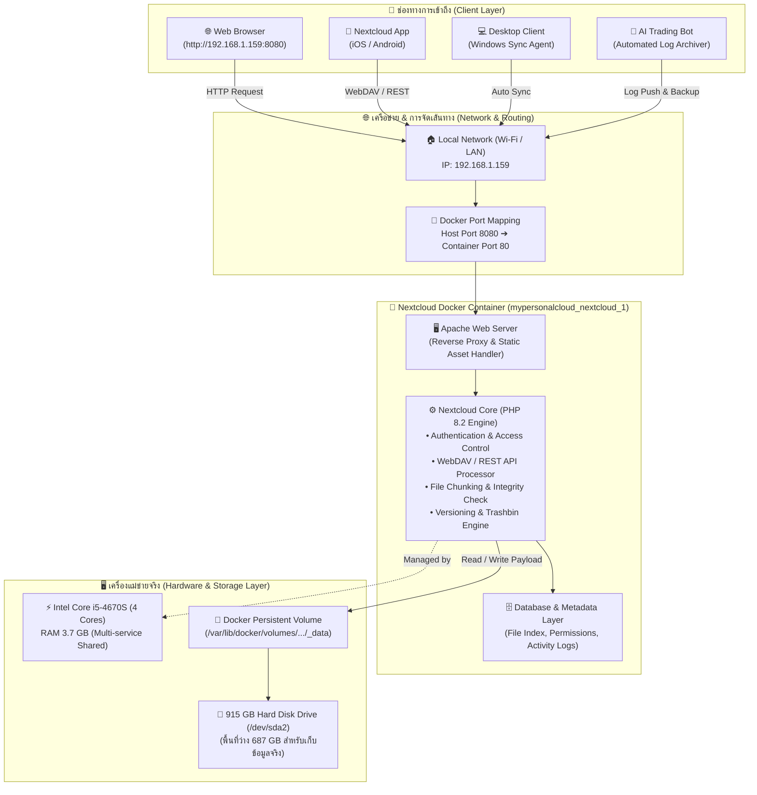
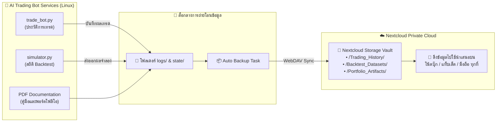

# ☁️ Nextcloud Private Cloud Storage: System Architecture & Workflow
**เอกสารสถาปัตยกรรมและกระบวนการทำงานของระบบคลาวด์จัดเก็บข้อมูลส่วนตัว (Portfolio Documentation)**

---

## 📌 1. บทนำและแรงบันดาลใจ (Background & Motivation)

ในการพัฒนาโปรเจกต์ **AI Autonomous Trading Bot** และการทำงานด้านซอฟต์แวร์ จำเป็นต้องมีระบบจัดเก็บข้อมูล (Data Vault) ที่มีความจุสูง เสถียร และปลอดภัย สำหรับสำรองข้อมูลประวัติการซื้อขาย (Trade Logs), ฐานข้อมูลราคาย้อนหลัง (Historical CSVs), รายงานประสิทธิภาพ (PDF Reports) ตลอดจนไฟล์สื่อนำเสนอต่าง ๆ

### ปัญหาของการใช้ Public Cloud ทั่วไป (Pain Points):
1. **มีค่าใช้จ่ายต่อเนื่อง (Recurring Cost):** บริการอย่าง Google Drive, iCloud หรือ OneDrive คิดค่าบริการรายเดือนเมื่อพื้นที่เกินกำหนด
2. **ข้อจำกัดด้านความเป็นส่วนตัว (Data Privacy & Sovereignty):** ข้อมูลถูกส่งไปเก็บไว้บนเซิร์ฟเวอร์ของบุคคลที่สาม
3. **การเชื่อมต่ออัตโนมัติ (API Integration):** การเขียนสคริปต์สำรองข้อมูลอัตโนมัติผ่านคลาวด์สาธารณะมักมีข้อจำกัดเรื่อง API Quota และความซับซ้อนของ OAuth2

### ทางออกทางวิศวกรรม (The Engineering Solution):
ผู้พัฒนาได้เลือกสร้าง **Self-Hosted Private Cloud** ด้วย **Nextcloud Hub (v33.0.1)** รันบนเครื่องแม่ข่าย **Ubuntu 24.04 LTS (Lenovo ThinkCentre E73)** ผ่านเทคโนโลยี **Docker Container** ทำให้ได้พื้นที่จัดเก็บข้อมูลส่วนตัวขนาดใหญ่ถึง **915 GB (ใช้งานได้ฟรี 0 บาทตลอดชีพ)** โดยที่ข้อมูลทั้งหมดอยู่ภายใต้การควบคุมของเรา 100%

---

## 📊 2. แผนผังกระบวนการทำงานภาพรวม (System Workflow Diagram)

---

## 🔄 3. เจาะลึก 5 ลำดับขั้นการทำงานของระบบ (Step-by-Step System Flow)

### ขั้นที่ 1: การส่งคำขอเข้าถึง (User & Automation Ingress)
ระบบรองรับการเข้าถึงพร้อมกันจากหลายช่องทาง:
1. **ผ่านเว็บเบราว์เซอร์ (Web Interface):** เข้าใช้งานผ่านหน้าเว็บ GUI ที่สวยงามบนพอร์ต `8080` เพื่อจัดการไฟล์ อัปโหลด ดาวน์โหลด หรือแชร์ลิงก์
2. **ผ่านแอปพลิเคชันมือถือ & คอมพิวเตอร์ (Client Sync):** ซิงก์โฟลเดอร์อัตโนมัติทันทีที่มีไฟล์ใหม่เพิ่มเข้ามา (Real-time synchronization)
3. **ผ่านโปรโตคอล WebDAV / REST API:** อนุญาตให้บอทเทรด Python สามารถส่งไฟล์บันทึกการเทรด (`trades.csv`) และรายงาน PDF เข้ามาสำรองข้อมูลได้อัตโนมัติผ่านโค้ด

### ขั้นที่ 2: การจัดเส้นทางผ่าน Docker Container (Port Mapping & Isolation)
* คำขอทั้งหมดที่เข้ามาที่ `192.168.1.159:8080` จะถูก Docker Engine นำทางเข้าสู่คอนเทนเนอร์ `mypersonalcloud_nextcloud_1` ที่พอร์ต `80` (HTTP) ภายใน
* **ข้อดีของการใช้ Docker:** ระบบ Nextcloud จะถูกแยกสภาพแวดล้อม (Isolated Environment) ออกจากระบบเทรด `mt5-server` และสคริปต์ของบอท ทำให้มั่นใจได้ว่าหากมีบริการใดบริการหนึ่งเกิดปัญหา จะไม่ส่งผลกระทบต่อบริการอื่นในเครื่องเดียวกัน

### ขั้นที่ 3: แกนประมวลผล Nextcloud Hub (Application Core Engine)
* **Apache & PHP Engine:** ทำหน้าที่ตรวจสอบสิทธิ์ผู้ใช้งาน (Authentication), ตรวจสอบโทเคน (Session Token) และจัดการสิทธิ์การเข้าถึงไฟล์
* **File Chunking (การตัดชิ้นไฟล์):** เมื่อมีการอัปโหลดไฟล์ขนาดใหญ่ (เช่น วิดีโอพอร์ตโฟลิโอ หรือไฟล์ฐานข้อมูล) ระบบจะตัดไฟล์ออกเป็นชิ้นย่อย ๆ (Chunks) อัปโหลดทีละชิ้น และประกอบกลับอัตโนมัติ เพื่อป้องกันการอัปโหลดล้มเหลวเวลาระบบเน็ตสะดุด
* **Data Integrity (การตรวจสอบความถูกต้อง):** มีการคำนวณ Checksum ของไฟล์ทุกครั้ง เพื่อยืนยันว่าไฟล์ที่บันทึกถูกต้องตรงกับต้นฉบับ 100%

### ขั้นที่ 4: การจัดการข้อมูลโครงสร้าง (Metadata & Indexing Layer)
* ฐานข้อมูลจะบันทึกโครงสร้างลำดับโฟลเดอร์, ชื่อไฟล์, ขนาด, วันที่สร้าง, แท็ก, สิทธิ์การเข้าถึง และสถิติการใช้งาน
* **File Versioning (ระบบเก็บเวอร์ชันย้อนหลัง):** หากมีการอัปเดตหรือเซฟทับไฟล์เดิม (เช่น การอัปเดตไฟล์โค้ดหรือเอกสารงาน) Nextcloud จะบันทึกประวัติย้อนหลังไว้ ทำให้สามารถย้อนเวลากลับไปกู้เวอร์ชันก่อนหน้าได้ตลอดเวลา ป้องกันข้อผิดพลาดจากการแก้ไขทับ

### ขั้นที่ 5: การจัดเก็บบนฮาร์ดดิสก์จริง (Physical Storage Layer)
* คอนเทนเนอร์เชื่อมต่อพื้นที่จัดเก็บผ่าน **Docker Volume** เข้ากับพื้นที่ฮาร์ดดิสก์จริงบน Ubuntu (`/dev/sda2`)
* เครื่องแม่ข่ายนี้มีพื้นที่จัดเก็บรวม **915 GB** และมีพื้นที่ว่างพร้อมใช้งานมากถึง **687 GB** รองรับการสำรองข้อมูลโปรเจกต์ ไฟล์วิดีโอนำเสนอ และข้อมูลการเทรดได้ต่อเนื่องหลายปี

---

## 🤝 4. การทำงานร่วมกันระหว่าง Nextcloud กับ AI Trading Bot (Ecosystem Synergy)

1. **คลังเก็บข้อมูลราคาทองคำ (Market Data Vault):** เก็บไฟล์แท่งเทียนย้อนหลัง 12,000 แท่ง สำหรับนำไปใช้ทดสอบ Backtest
2. **สำรองประวัติการเทรดอัตโนมัติ (Automated Trade Logging):** ไฟล์ `trades.csv` และ `events.csv` สามารถซิงก์ตรงเข้าสู่โฟลเดอร์ของ Nextcloud ทำให้เราเปิดดูประวัติกำไร/ขาดทุนจากมือถือได้ทุกที่
3. **ศูนย์รวมเอกสารโครงงาน (Project Documentation Hub):** ไฟล์ PDF คู่มือสถาปัตยกรรมระบบ รูปภาพสกรีนช็อต และสไลด์นำเสนอ ถูกจัดเก็บไว้ในคลาวด์ส่วนตัวนี้ เพื่อให้พร้อมดาวน์โหลดนำเสนอในวันแข่งขันหรือวันสัมภาษณ์

---

## 💡 5. จุดเด่นทางเทคนิคสำหรับนำเสนอในพอร์ตโฟลิโอ (Portfolio Highlights)

| คุณสมบัติ (Feature) | วิธีการทำงานทางวิศวกรรม | ประโยชน์ที่ได้รับในโปรเจกต์ |
| :--- | :--- | :--- |
| **Self-Hosted 100%** | ติดตั้งและรันบนเครื่องคอมพิวเตอร์ Ubuntu ของตนเอง | ข้อมูลมีความเป็นส่วนตัวสูงสุด ไม่ถูกส่งออกนอกระบบ |
| **Zero Monthly Cost** | ใช้เทคโนโลยี Open-Source (Nextcloud + Docker) | ประหยัดค่าเช่า Cloud Storage รายเดือน เหลือ 0 บาทตลอดชีพ |
| **High Storage Capacity** | ใช้ประโยชน์จาก Hard Disk 915 GB (เหลือว่าง 687 GB) | มีพื้นที่จุข้อมูลมหาศาล รองรับไฟล์วิดีโอและดาต้าเซ็ตขนาดใหญ่ |
| **Container Virtualization** | ควบคุมผ่าน Docker Engine พร้อมจำกัดพอร์ต `8080:80` | แยกส่วนการทำงานชัดเจน ไม่รบกวนบอทเทรด MT5 ในเครื่องเดียวกัน |
| **Cross-Platform Access** | รองรับทั้ง Web, Windows, macOS, Android, iOS | สามารถเปิดดูผลงานและดึงไฟล์ไปพรีเซนต์ในวันสัมภาษณ์ได้ทันที |

---

> 📝 **สรุปสำหรับกรรมการ / ผู้ตรวจพอร์ต:**  
> *"การมีระบบ Nextcloud ในโครงงานนี้ สะท้อนถึงความเข้าใจด้าน **System Administration, DevOps และ Cloud Infrastructure** โดยผู้พัฒนาสามารถนำฮาร์ดแวร์ทั่วไปมาเปลี่ยนเป็นเซิร์ฟเวอร์อเนกประสงค์ที่รองรับทั้ง **AI Trading Bot 24 ชั่วโมง** และ **Private Cloud Storage** ได้อย่างมีประสิทธิภาพสูงสุด"*
