# 🏆 AI-Powered Autonomous Gold Trading System (Version 5)
### *Enterprise Multi-Agent Algorithmic Trading Engine • Real-Time Macro News AI • Zero-Cost Self-Hosted Private Cloud*

[](https://www.python.org/)
[](https://www.metatrader5.com/)
[](https://www.docker.com/)
[](https://ubuntu.com/)
[](https://groq.com/)
[](https://ai.google.dev/)
[](https://discord.py/)
[](LICENSE)
[](#)

---

## 📌 Executive Summary

**AI-Powered Autonomous Gold Trading System (ai_trading_bot_2)** คือระบบเทรดทองคำ (`XAUUSD`) อัตโนมัติระดับสถาบันที่ถูกพัฒนาขึ้นเพื่อแก้ปัญหาความเหนื่อยล้าและอคติทางอารมณ์ของมนุษย์ โดยผสมผสาน **การวิเคราะห์เชิงปริมาณ (Quantitative Analysis)**, **โมเดลปัญญาประดิษฐ์อ่านข่าวเศรษฐกิจมหภาค (Generative AI News Sentiment)**, และ **โครงสร้างพื้นฐานเซิร์ฟเวอร์ส่วนตัวต้นทุน 0 บาท (Self-Hosted Ubuntu Cloud & Docker)** เข้าด้วยกันอย่างสมบูรณ์แบบ ควบคุมและสั่งการได้แบบเรียลไทม์ผ่านมือถือบน **Discord Command Center**

```
┌──────────────────────────────────────────────────────────────────────────────────────────────────┐
│                                       KEY PROJECT HIGHLIGHTS                                     │
├───────────────────────────────┬──────────────────────────────────┬───────────────────────────────┤
│ 📈 Quantitative Strategy V5   │ 🤖 Dual-Engine News AI           │ ☁️ Zero-Cost Cloud Infra       │
│ • Trend-Pullback (SMA+RSI)    │ • Sub-second Groq Llama 3.3/Qwen │ • Lenovo ThinkCentre Repurpose│
│ • Volatility Sizing (ATR 14)  │ • Auto-fallback to Gemini Flash  │ • Docker MT5 (Wine + Xvfb)    │
│ • Circuit Breaker: 3% Max Loss│ • Gated sentiment (-1.0 to +1.0) │ • RAM footprint: only ~1.5 GB │
└───────────────────────────────┴──────────────────────────────────┴───────────────────────────────┘
```

### 1. ปัญหาและแรงบันดาลใจ (Pain Points Addressed)
1. **24/7 Screen Fatigue & Mental Strain:** ตลาดทองคำโลกเคลื่อนไหวตลอด 24 ชั่วโมง การเฝ้าดูกราฟต่อเนื่องส่งผลเสียต่อสุขภาพกายและสุขภาพจิต
2. **Emotional Trading & Revenge Trades:** ความกลัวตกรถ (FOMO) และการเอาคืนตลาดเมื่อขาดทุน เป็นสาเหตุอันดับ 1 ที่ทำให้พอร์ตพัง
3. **Macroeconomic News Blindspot:** ข่าวเศรษฐกิจสำคัญ (Fed Rates, CPI, NFP) ประกาศตามเวลากลางคืนของฝั่งสหรัฐฯ ทำให้เทรดเดอร์รายย่อยวิเคราะห์และตอบสนองไม่ทันท่วงที
4. **Prohibitive Cloud Infrastructure Costs:** ค่าเช่า Cloud VPS คุณภาพสูง ($20–$50/เดือน) และค่าบริการ Cloud API สำหรับ MT5 ($30–$100/เดือน) สร้างภาระต้นทุนสูงต่อเนื่อง

### 2. นวัตกรรมและการแก้ไขปัญหา (Engineering Innovations)
- **Zero Human Emotion:** การเข้าและปิดออเดอร์ถูกควบคุมด้วยเงื่อนไขทางคณิตศาสตร์ 4 ชั้น พร้อมคุมความเสี่ยงตายตัว 1.0% ต่อไม้
- **Sub-Second News Intelligence:** บอทดึงข่าว RSS จากสำนักข่าวชั้นนำทั่วโลก และใช้ LLM วิเคราะห์คะแนน Sentiment ภายในเสี้ยววินาที เพื่อยับยั้งการออกออเดอร์ที่สวนทิศทางข่าวแรง
- **Complete Self-Hosted DevOps:** แปลงเครื่องเดสก์ท็อปเก่าให้เป็น Linux Cloud Server รัน MT5 Windows ผ่าน Wine + Docker โดยมีต้นทุนรายเดือน **0 บาท**
- **Mobile-First Command Center:** ควบคุม ดูพอร์ต และปรับแต่งพารามิเตอร์ผ่าน Discord Slash Commands 13 คำสั่ง พร้อมฟังก์ชัน **Supreme Error Catcher** แปลง Log ซับซ้อนเป็นภาษาไทยสรุป 1 ประโยค

---

## 🏛️ System Architecture (สถาปัตยกรรมระบบ)

ระบบได้รับการออกแบบเชิงวิศวกรรมแบบ **Multi-Process Micro-Agent Architecture** ขับเคลื่อนด้วย Linux Systemd Service (`ai-trading.service`) และมีตัวกำกับดูแลอัตโนมัติ (`run_all.py` Watchdog)

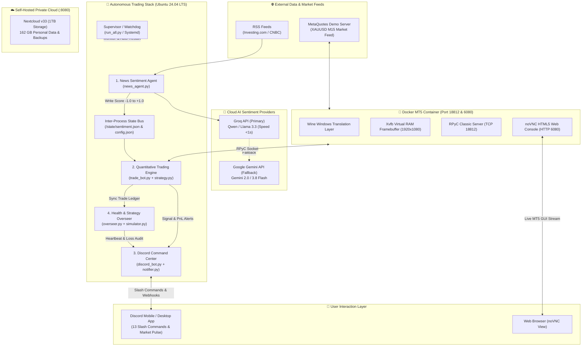

### รายละเอียด 4 โมดูลหลัก (Core Micro-Services)
| โมดูล | ไฟล์หลัก | หน้าที่การทำงาน | กลไกความปลอดภัย / จุดเด่น |
|---|---|---|---|
| **1. News Agent** | [`news_agent.py`](file:///f:/code/%E0%B8%87%E0%B8%B2%E0%B8%99/antigravity/%E0%B9%81%E0%B8%82%E0%B9%88%E0%B8%87/AWS%20Thaksa%20AI/ai_trading_bot_2/news_agent.py) | ตรวจจับข่าว RSS ทุก 30 นาที กรองข่าวซ้ำ และส่งให้ AI ประเมิน Sentiment (-1.0 ถึง +1.0) | Multi-provider fallback (Groq ➔ Gemini), ข้ามการยิง AI หากไม่มีข่าวใหม่เพื่อประหยัดโควต้า |
| **2. Trade Engine** | [`trade_bot.py`](file:///f:/code/%E0%B8%87%E0%B8%B2%E0%B8%99/antigravity/%E0%B9%81%E0%B8%82%E0%B9%88%E0%B8%87/AWS%20Thaksa%20AI/ai_trading_bot_2/trade_bot.py), [`strategy.py`](file:///f:/code/%E0%B8%87%E0%B8%B2%E0%B8%99/antigravity/%E0%B9%81%E0%B8%82%E0%B9%88%E0%B8%87/AWS%20Thaksa%20AI/ai_trading_bot_2/strategy.py) | รันลูปคำนวณกราฟแท่งเทียน M15 ทุก 30 วินาที คัดกรองด้วยอินดิเคเตอร์ 4 ตัว และยิงคำสั่งเข้า MT5 | **Zero Repainting:** ตัดสินใจเฉพาะแท่งเทียนที่ปิดสมบูรณ์แล้วเท่านั้น, คุมความเสี่ยง 1% ต่อไม้ |
| **3. Discord Center** | [`discord_bot.py`](file:///f:/code/%E0%B8%87%E0%B8%B2%E0%B8%99/antigravity/%E0%B9%81%E0%B8%82%E0%B9%88%E0%B8%87/AWS%20Thaksa%20AI/ai_trading_bot_2/discord_bot.py), [`notifier.py`](file:///f:/code/%E0%B8%87%E0%B8%B2%E0%B8%99/antigravity/%E0%B9%81%E0%B8%82%E0%B9%88%E0%B8%87/AWS%20Thaksa%20AI/ai_trading_bot_2/notifier.py) | รับคำสั่ง Slash Commands 13 คำสั่ง, รายงาน Market Pulse ทุก 15 นาที, แจ้งเตือนสถานะพอร์ต | **Supreme Error Catcher:** AI แปลง Error ซับซ้อนเป็นภาษาไทยสรุป 1 ประโยคทันที |
| **4. AI Overseer** | [`overseer.py`](file:///f:/code/%E0%B8%87%E0%B8%B2%E0%B8%99/antigravity/%E0%B9%81%E0%B8%82%E0%B9%88%E0%B8%87/AWS%20Thaksa%20AI/ai_trading_bot_2/overseer.py), [`simulator.py`](file:///f:/code/%E0%B8%87%E0%B8%B2%E0%B8%99/antigravity/%E0%B9%81%E0%B8%82%E0%B9%88%E0%B8%87/AWS%20Thaksa%20AI/ai_trading_bot_2/simulator.py) | ตรวจ Heartbeat ทุก 15 นาที, ตรวจจับการแพ้ติดกัน 4 ไม้ และรัน Backtest 12,000 แท่งประจำสัปดาห์ | **7-Layer Safety Sandbox:** ล็อกสิทธิ์ห้าม AI แก้ไขไฟล์ระบบนอกเหนือจากพารามิเตอร์กลยุทธ์ |

---

## 🎯 Quantitative Strategy V5 (เจาะลึกสมองกลยุทธ์ V5)

กลยุทธ์หัวใจของระบบถูกพัฒนาขึ้นภายใต้แนวคิด **"Trend-Pullback + Momentum + Dynamic Volatility + Macro Sentiment Gate"** โดยใช้ระบบตัวกรองเชิงปริมาณ 4 ชั้น ผสานกับตัวกรองข่าว AI อีก 1 ชั้น (4+1 System) เพื่อให้มั่นใจว่าจะเข้าเทรดเฉพาะจังหวะที่มีความได้เปรียบทางสถิติสูงสุดเท่านั้น

```
  ┌─────────────────────────────────────────────────────────────────────────────┐
  │                            STRATEGY V5 PIPELINE                             │
  │                                                                             │
  │   [Close Price vs SMA 50] ──> เทรนด์หลักชัดเจน?                             │
  │             │                                                               │
  │             ▼ (YES)                                                         │
  │   [ADX 14 >= 25]          ──> ตลาดมีพลังขับเคลื่อน (ไม่แกว่งไซด์เวย์)?      │
  │             │                                                               │
  │             ▼ (YES)                                                         │
  │   [RSI 14 Pullback Cross] ──> เกิดจังหวะย่อตัวแล้วดีดกลับตามแนวโน้ม?        │
  │             │                                                               │
  │             ▼ (YES)                                                         │
  │   [AI News Sentiment]     ──> ข่าวเศรษฐกิจโลกไม่ขัดแย้งกับทิศทางเทรด?       │
  │             │                                                               │
  │             ▼ (PASSED)                                                      │
  │    🚀 EXECUTE TRADE (Lot คำนวณจากความเสี่ยง 1%, SL = 1.5 ATR, TP = 2.0 ATR) │
  └─────────────────────────────────────────────────────────────────────────────┘
```

### 1. สูตรอินดิเคเตอร์เชิงคณิตศาสตร์ (4 Indicators)
1. **SMA 50 (Simple Moving Average 50 แท่ง):**
   - $\text{Price} > \text{SMA}_{50}$ ➔ แนวโน้มขาขึ้น (พิจารณาเฉพาะฝั่ง **BUY**)
   - $\text{Price} < \text{SMA}_{50}$ ➔ แนวโน้มขาลง (พิจารณาเฉพาะฝั่ง **SELL**)
2. **ADX 14 (Average Directional Index เกณฑ์ $\ge 25$):**
   - กรองสภาวะตลาดไซด์เวย์ไร้ทิศทาง (Sideways Filter) หาก $\text{ADX} < 25$ บอทจะสั่ง **WAIT** ทันที เพื่อป้องกันการโดนตัด Stop Loss ซ้ำซาก
3. **RSI 14 (Relative Strength Index เกณฑ์ $45 / 55$):**
   - **BUY Signal:** ในเทรนด์ขาขึ้น ราคาย่อตัวลงมาทำให้ $\text{RSI} < 45$ แล้วแท่งล่าสุดดีดตัดทะลุกลับขึ้นไป ($\text{RSI}_{t-1} \le 45$ และ $\text{RSI}_t > 45$)
   - **SELL Signal:** ในเทรนด์ขาลง ราคาเด้งตัวขึ้นทำให้ $\text{RSI} > 55$ แล้วแท่งล่าสุดตบกลับทะลุลงมา ($\text{RSI}_{t-1} \ge 55$ และ $\text{RSI}_t < 55$)
4. **ATR 14 (Average True Range Dynamic Stop):**
   - คำนวณระยะตัดขาดทุนและทำกำไรตามความผันผวนจริงของแท่งเทียน:
     $$\text{Stop Loss (SL)} = \text{Entry Price} \pm (1.5 \times \text{ATR}_{14})$$
     $$\text{Take Profit (TP)} = \text{Entry Price} \mp (2.0 \times \text{ATR}_{14})$$
   - อัตราส่วนความคุ้มค่า **Risk : Reward Ratio = 1 : 1.33**

### 2. ตัวกรองข่าวสารเศรษฐกิจมหภาค (AI Sentiment Gate)
- หากเกิดสัญญาณ **BUY** ทางเทคนิค แต่คะแนนข่าว $\text{Sentiment} < 0$ ➔ **ยกเลิกคำสั่งซื้อทันที**
- หากเกิดสัญญาณ **SELL** ทางเทคนิค แต่คะแนนข่าว $\text{Sentiment} > 0$ ➔ **ยกเลิกคำสั่งขายทันที**

### 3. กลไกบริหารความเสี่ยงระดับสถาบัน (Risk Management Engine)
- **1.0% Fixed Fractional Risk:** คำนวณ Lot อัตโนมัติจากระยะทางของ Stop Loss เพื่อล็อกความเสียหายสูงสุดต่อไม้ไว้ที่ 1.0% ของ Equity เสมอ
- **Max Open Trades = 1:** เปิดคำสั่งได้เพียง 1 ไม้ในเวลาเดียวกัน ปราศจากระบบเบิ้ลไม้ Martingale หรือ Grid โดยสิ้นเชิง
- **Daily Loss Circuit Breaker (3.0%):** หากผลรวมขาดทุนในรอบวันถึง 3.0% ระบบจะตัดวงจรล็อกการเทรดอัตโนมัติจนกว่าจะขึ้นวันทำการใหม่

---

## 📊 Empirical Track Record & Backtest Results (ผลทดสอบเชิงประจักษ์)

การทดสอบย้อนหลังถูกดำเนินการด้วยโมดูล [`simulator.py`](file:///f:/code/%E0%B8%87%E0%B8%B2%E0%B8%99/antigravity/%E0%B9%81%E0%B8%82%E0%B9%88%E0%B8%87/AWS%20Thaksa%20AI/ai_trading_bot_2/simulator.py) บนชุดข้อมูลราคาทองคำจริง `XAUUSD` ไทม์เฟรม `M15` บันทึกตามมาตรฐานแบบอนุรักษ์นิยมสูงสุด:
- **รวมค่าธรรมเนียมถ่าง Spread จริง:** คิดค่า Spread **$0.30 ต่อออนซ์** ในทุกออเดอร์
- **Pessimistic Tie-break Rule:** หากในแท่งเดียวกันราคามีทั้ง High และ Low ชนทั้ง TP และ SL ระบบจะตัดสินว่าชน **Stop Loss ก่อนเสมอ** (ป้องกันผลทดสอบเกินจริง)
- **Zero Look-ahead Bias:** เข้าออเดอร์ที่ราคา Open ของแท่งถัดไปหลังสัญญาณปิดแท่งสมบูรณ์เท่านั้น

### ตารางสรุปผลการทดสอบหลายช่วงเวลา (Multi-Horizon Validation)
| ชุดการทดสอบ | จำนวนแท่ง (M15 Bars) | ระยะเวลาเทียบเท่า | จำนวนไม้ทั้งหมด | อัตราชนะ (Win Rate) | Profit Factor | Drawdown สูงสุด | กำไรสุทธิ (USD) | ผลตอบแทนสุทธิ (%) |
|---|:---:|:---:|:---:|:---:|:---:|:---:|:---:|:---:|
| **Standard 6-Month** | **12,000 bars** | ~6 เดือน | 76 ไม้ | **50.00%** (BUY 53.5% / SELL 45.5%) | **1.33** | **5.89%** | **+$1,322.25** | **+13.22%** |
| **Annual 1-Year** | **24,000 bars** | ~1 ปี | 146 ไม้ | **47.26%** (BUY 48.5% / SELL 46.2%) | **1.18** | **9.32%** | **+$1,484.47** | **+14.84%** |
| **Comprehensive 2-Year** | **45,000 bars** | ~2.2 ปี | 230 ไม้ | **47.83%** (BUY 48.7% / SELL 47.1%) | **1.21** | **8.66%** | **+$2,907.35** | **+29.07%** |

```
  ========================================================================
    Strategy V5 Performance Curve: Initial Balance $10,000.00
  ========================================================================
  • 12,000 Bars: $11,322.25 (+13.22% Net Profit | Max Drawdown 5.89%)
  • 24,000 Bars: $11,484.47 (+14.84% Net Profit | Max Drawdown 9.32%)
  • 45,000 Bars: $12,907.35 (+29.07% Net Profit | Max Drawdown 8.66%)
  ========================================================================
```

> **💡 ข้อสังเกตเชิงสถิติ (Statistical Insight):**
> กลยุทธ์สามารถรักษา Profit Factor ได้เกิน **1.20 – 1.33** และรักษาระดับ Maximum Drawdown ให้อยู่ต่ำกว่า **9.32%** ตลอดระยะเวลาการจำลองกว่า 45,000 แท่งเทียน ซึ่งต่ำกว่าเกณฑ์มาตรฐานความเสี่ยงทั่วไปของกองทุนส่วนบุคคล (20%) อย่างมีนัยสำคัญ

---

## 🎮 Discord Command Center (ศูนย์บัญชาการ 13 คำสั่ง)

ระบบรองรับการควบคุมระยะไกลผ่าน Discord Slash Commands ครอบคลุมทั้งการมอนิเตอร์ การสั่งเทรดฉุกเฉิน และการวิเคราะห์ย้อนหลัง:

| หมวดหมู่ | คำสั่ง (Slash Command) | ไวยากรณ์ตัวอย่าง | คำอธิบายการทำงาน |
|---|---|---|---|
| **Monitoring & Telemetry** | `/status` | `/status` | รายงานสถานะสุขภาพบอท 4 ตัว, ยอดเงิน Balance/Equity, ค่าอินดิเคเตอร์ปัจจุบัน, และคะแนนข่าว AI |
| | `/positions` | `/positions` | แสดงรายการออเดอร์ที่กำลังเปิดอยู่ พร้อมคำนวณกำไร/ขาดทุนลอยตัว (Floating PnL) แบบเรียลไทม์ |
| | `/config` | `/config` | ตรวจสอบค่าคอนฟิกปัจจุบันทั้งหมดของระบบ เช่น Risk%, สัญลักษณ์, ช่วงเวลาตรวจข่าว |
| | `/help` | `/help` | เมนูช่วยเหลือแนะนำการใช้งานคำสั่งทั้งหมดในรูปแบบ Interactive Embed |
| **Manual Execution & Control** | `/buy` | `/buy lot:0.1` | ส่งคำสั่ง BUY ทันที (หากไม่ระบุ Lot บอทจะคำนวณความเสี่ยง 1% พร้อมวาง SL/TP อัตโนมัติ) |
| | `/sell` | `/sell lot:0.1` | ส่งคำสั่ง SELL ทันที พร้อมผูกระยะ Stop Loss และ Take Profit ตามค่า ATR ล่าสุด |
| | `/close` | `/close ticket:12345` | สั่งปิดออเดอร์ทันที (เลือกปิดเฉพาะหมายเลข Ticket หรือปิดทั้งหมดในพอร์ต) |
| | `/pause` | `/pause reason:NonFarm` | หยุดการออกออเดอร์อัตโนมัติชั่วคราว (เช่น ช่วงมีข่าวตัวเลขเศรษฐกิจผันผวนรุนแรง) |
| | `/resume` | `/resume reason:MarketCalm` | เปิดให้บอทกลับมาทำการวิเคราะห์และออกออเดอร์อัตโนมัติตามปกติ |
| **Quant Analysis & Tuning** | `/simulate` | `/simulate bars:12000` | รันเครื่องมือจำลองเทรดย้อนหลังบนเซิร์ฟเวอร์ และส่งการ์ดสรุปผลกำไร/Win Rate กลับเข้าแชท |
| | `/set_timeframe` | `/set_timeframe tf:M15` | เปลี่ยนไทม์เฟรมเทรด (`M1`, `M5`, `M15`, `M30`, `H1`, `H4`) และรีโหลดโมดูลอัตโนมัติ |
| | `/set_symbol` | `/set_symbol symbol:XAUUSD` | สลับคู่เงินหรือสินทรัพย์ที่เทรด (เช่น `XAUUSD`, `BTCUSD`, `EURUSD`) |
| | `/set_risk` | `/set_risk risk:1.5` | ปรับตั้งค่าเปอร์เซ็นต์ความเสี่ยงต่อไม้ (ระบบล็อกเพดานความปลอดภัยไม่เกิน 5.0%) |

---

## 🖥️ Self-Hosted Infrastructure & DevOps Blueprint

จุดเด่นด้านวิศวกรรมระบบของโปรเจกต์นี้คือการนำฮาร์ดแวร์เดสก์ท็อป **Lenovo ThinkCentre E73** มาดัดแปลง (Repurpose) ให้กลายเป็น **24/7 Enterprise Home Server** โดยไม่ต้องพึ่งพาคลาวด์รายเดือน

```
┌──────────────────────────────────────────────────────────────────────────────────────────────────┐
│                                HARDWARE & VIRTUALIZATION SPECIFICATION                           │
├───────────────────────┬──────────────────────────────────────────────────────────────────────────┤
│ Host Machine          │ Lenovo ThinkCentre E73 Desktop Chassis (BIOS: FCKT46AUS)                 │
│ Operating System      │ Ubuntu 24.04.4 LTS (Noble Numbat) | Kernel: Linux 7.0.0-38-generic       │
│ CPU Processor         │ Intel® Core™ i5-4670S @ 3.10GHz (4 Cores / 4 Threads, Turbo 3.80GHz)     │
│ Memory Footprint      │ 4 GB DDR3 @ 1333 MT/s (Total System Usage: only 1.5 GiB / 3.7 GiB)       │
│ Storage Subsystem     │ 1 TB Western Digital Blue HDD (sda2: 915 GB ext4, Free: 687 GB)          │
│ Networking            │ Gigabit Ethernet Realtek RTL8111 + Tailscale Encrypted Mesh VPN          │
├───────────────────────┼──────────────────────────────────────────────────────────────────────────┤
│ Container: mt5-server │ Image: lprett/mt5linux:latest (Wine 9.0 + Xvfb 1920x1080 + RPyC 18812)   │
│ Web GUI Stream        │ x11vnc + noVNC HTML5 WebSocket Server on Port 6080                       │
│ Co-located Nextcloud  │ Nextcloud v33.0.1.2 on Port 8080 (162 GB personal cloud data hosted)    │
│ Systemd Daemon        │ ai-trading.service (Total RAM consumption of 5 processes: ~365 MB)      │
│ Operational Cost      │ $0.00 / Month (Zero recurring SaaS / VPS / API subscriptions)            │
└───────────────────────┴──────────────────────────────────────────────────────────────────────────┘
```

### การรัน MT5 Windows บน Linux ผ่าน Docker และ Wine
เนื่องจาก MetaTrader 5 ทำงานเฉพาะบน Windows เราจึงนำเทคนิค Virtualization มาใช้:
1. **Wine Layer:** รันโปรแกรม 64-bit `terminal64.exe` บน Ubuntu โดยไม่กินทรัพยากรเสมือน VM
2. **Xvfb (X Virtual Framebuffer):** จำลองจอภาพ 1920x1080 ขึ้นในหน่วยความจำ RAM เพื่อให้ MT5 วาดกราฟได้แม้เซิร์ฟเวอร์ไม่ได้ต่อหน้าจอจริง
3. **RPyC Socket (Port 18812):** เปิดช่องทางการสื่อสารระดับ Process ให้อ็อบเจกต์ Python ของ `trade_bot.py` ดึงกราฟราคาและส่งคำสั่งเข้า MT5 ได้ด้วยความหน่วงต่ำกว่า 5 มิลลิวินาที
4. **noVNC Web Interface (Port 6080):** เข้าดูหน้าจอโปรแกรม MT5 แบบสด ๆ ผ่านเว็บบราวเซอร์ได้จากมือถือหรือโน้ตบุ๊กทุกที่ผ่านเครือข่าย VPN

---

## 📸 Visual Showcase & Proof of Execution (แกลเลอรีภาพถ่ายระบบจริง)

### 1. Discord Command Center & Telemetry
| Discord Market Pulse (ทุก 15 นาที) | Backtest Simulation via Discord (`/simulate`) |
|:---:|:---:|
| 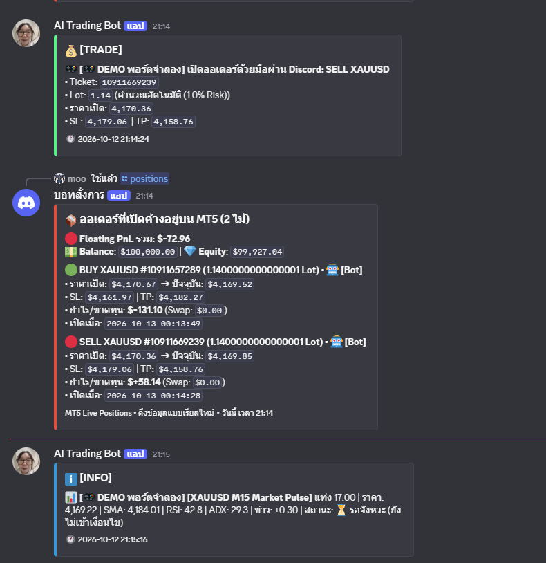 | 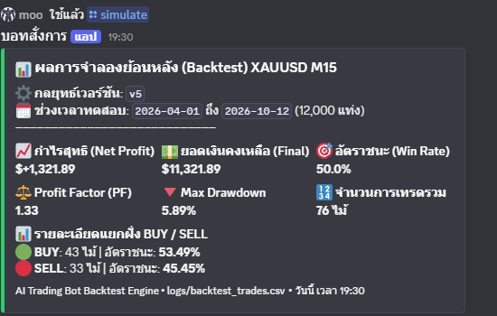 |

| Manual Order Execution via Slash Command (`/buy`) | Real-time Open Positions Tracking (`/positions`) |
|:---:|:---:|
| 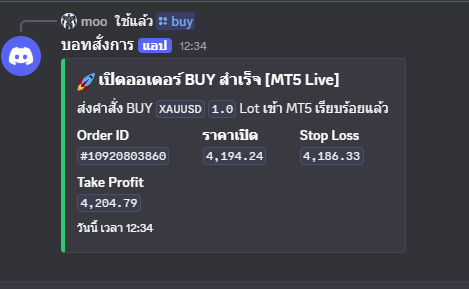 | 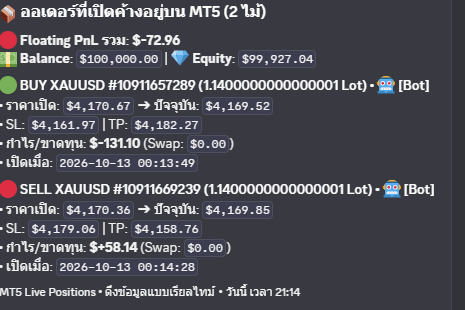 |

---

### 2. Live MT5 Server in Docker & noVNC Web GUI
| Live MT5 Terminal Running on Ubuntu Linux (Port 6080) | Quantitative Indicators (SMA 50, RSI 14, ADX, ATR) |
|:---:|:---:|
| 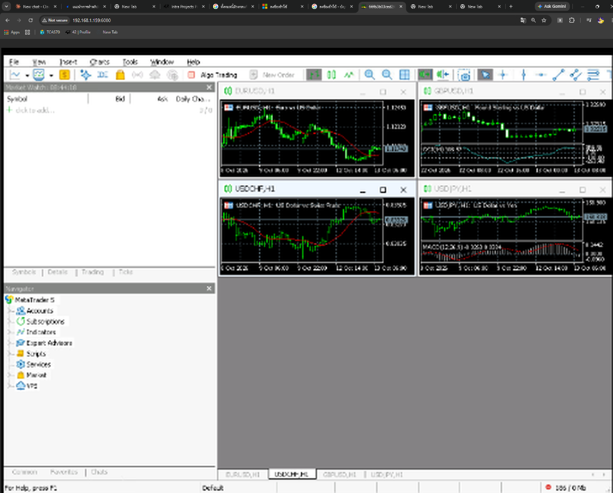 | 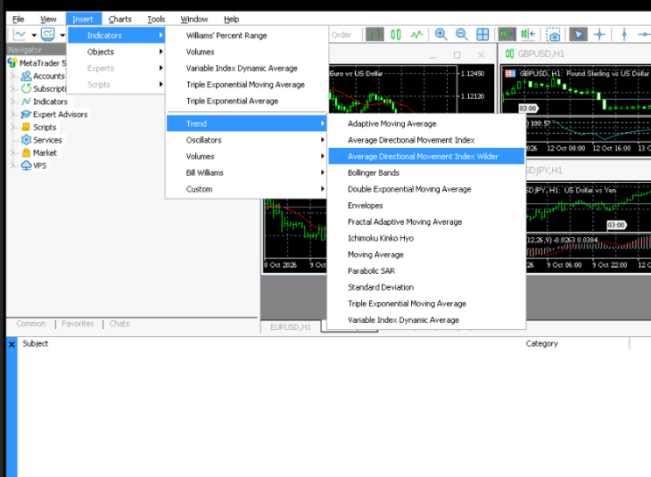 |

| Verified Real-time MT5 Terminal Order Execution | Verified Order History & Execution Tickets |
|:---:|:---:|
| 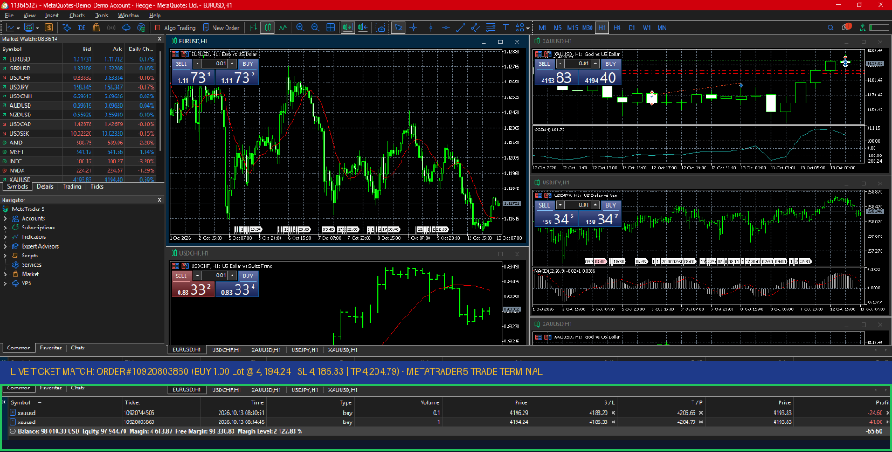 | 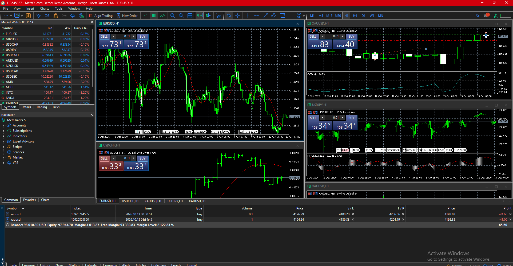 |

---

### 3. Linux Cloud Server & Co-located Nextcloud Private Cloud
| Ubuntu 24.04 Systemd Services & Containers Status | Co-located 1TB Nextcloud Private Cloud (Port 8080) |
|:---:|:---:|
| 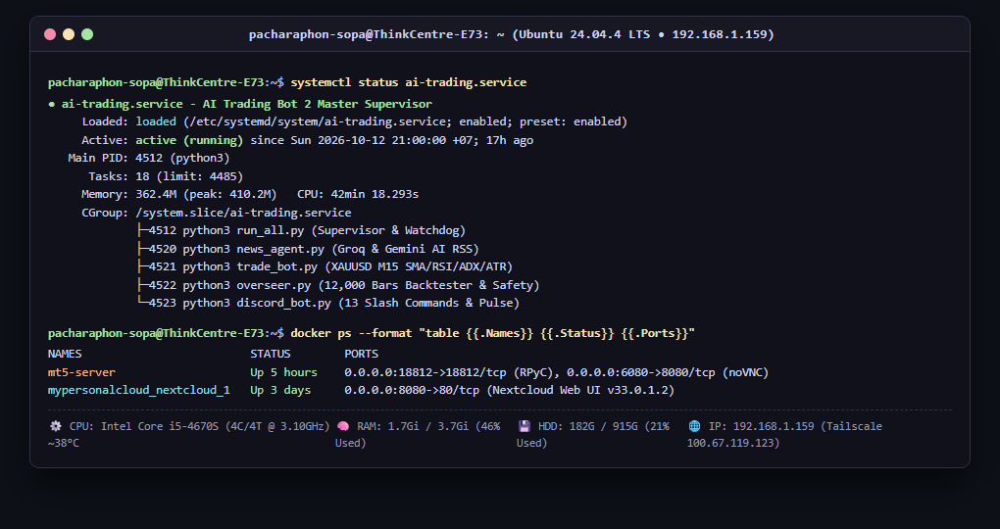 | 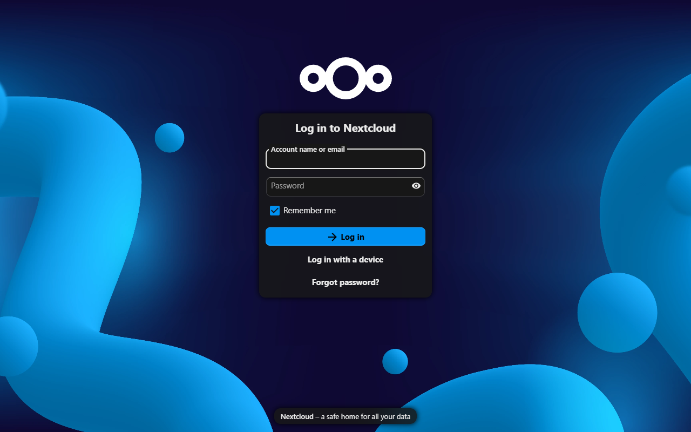 |

---

## 🛠️ Setup & Installation Guide (คู่มือการติดตั้งและใช้งาน)

### 1. ข้อกำหนดขั้นต่ำของระบบ (Prerequisites)
- **ระบบปฏิบัติการ:** Linux (Ubuntu 20.04/22.04/24.04 LTS แนะนำ) หรือ Windows 10/11
- **Python:** เวอร์ชัน 3.10 ขึ้นไป (แนะนำ 3.12)
- **Docker & Docker Compose** (สำหรับกรณีรัน MT5 Server ในคอนเทนเนอร์)
- **บัญชีโบรกเกอร์ MT5:** Demo หรือ Live Account (เช่น MetaQuotes-Demo)

### 2. ขั้นตอนการโคลนและเตรียม Environment
```bash
# 1. Clone repository
git clone https://github.com/Poxim009/AI_Trading.git
cd AI_Trading

# 2. สร้าง Virtual Environment
python3 -m venv .venv
source .venv/bin/activate  # บน Windows ใช้: .venv\Scripts\activate

# 3. ติดตั้ง Dependencies ทั้งหมด
pip install --upgrade pip
pip install -r requirements.txt
```

### 3. การกำหนดค่าตัวแปรสภาพแวดล้อม (.env Configuration)
คัดลอกไฟล์ตัวอย่าง `.env.example` เป็น `.env` และกรอกค่าคอนฟิกของท่าน:
```bash
cp .env.example .env
```
เปิดไฟล์ `.env` เพื่อระบุค่า:
```env
# Discord Settings
DISCORD_WEBHOOK_URL="https://discord.com/api/webhooks/..."
DISCORD_BOT_TOKEN="your_discord_bot_token"

# AI Sentiment API Keys
GROQ_API_KEY="gsk_..."
GEMINI_API_KEY="AQ...."

# MT5 Account Configuration (ผ่าน Docker RPyC หรือ Direct)
MT5_LOGIN="113645327"
MT5_PASSWORD="your_password"
MT5_SERVER="MetaQuotes-Demo"
MT5_DOCKER_HOST="127.0.0.1"
MT5_DOCKER_PORT=18812
```

### 4. การทดสอบความถูกต้องของระบบ (Automated Verification)
รันชุดทดสอบ Unit & Integration Tests ครบทั้ง 35 รายการ:
```bash
python test_suite.py
```
ผลลัพธ์ที่ถูกต้อง:
```text
Ran 35 tests in 0.610s
OK
```

### 5. การเปิดใช้งานระบบ (System Launch)
#### แบบรันเดี่ยว (Development Mode):
```bash
python run_all.py
```
#### แบบรัน 24/7 บน Linux Systemd (Production Mode):
```bash
sudo cp ai-trading.service /etc/systemd/system/
sudo systemctl daemon-reload
sudo systemctl enable --now ai-trading.service
sudo systemctl status ai-trading.service
```

---

## ⚖️ Honest Engineering Disclosure (การเปิดเผยข้อจำกัดทางวิศวกรรม)

เพื่อความโปร่งใสและแสดงถึงมาตรฐานทางวิศวกรรมอย่างตรงไปตรงมา:
1. **Low Trade Frequency by Design:** เนื่องจากกลยุทธ์ V5 คัดกรองเข้มงวดด้วยอินดิเคเตอร์ 4 ตัวร่วมกับคะแนนข่าว AI จึงมีค่าเฉลี่ยการออกออเดอร์ประมาณ 1 ไม้ทุก 1.5 – 2 วันทำการ (สัปดาห์ละ 3–4 ไม้) เพื่อหลีกเลี่ยงสัญญาณหลอก
2. **Forward Testing Phase:** ปัจจุบันระบบติดตั้งบนเซิร์ฟเวอร์เสร็จสมบูรณ์ 100% และเริ่มส่งคำสั่งเข้าบัญชี Demo แล้ว อยู่ในขั้นตอนการรันต่อเนื่องเพื่อสะสมสถิติกำไรจริงในตลาดสดให้ครบตามเกณฑ์ทางสถิติ (Law of Large Numbers)
3. **Home Infrastructure Redundancy:** สำหรับเซิร์ฟเวอร์ประจำบ้าน หากเกิดกรณีไฟฟ้าดับหรืออินเทอร์เน็ตขัดข้อง ออเดอร์ทุกตัวได้รับการคุ้มครองด้วยการฝังระดับ **Stop Loss และ Take Profit ไว้บนเซิร์ฟเวอร์ของโบรกเกอร์ทันที** ตั้งแต่จังหวะส่งคำสั่ง และระบบ Systemd ร่วมกับ Docker จะบูตตัวเองกลับมาทำงานต่อทันทีเมื่อไฟกลับมา

---

## 📜 License & Author

- **Developer:** Pacharaphon Sopa ([@Poxim009](https://github.com/Poxim009))
- **Project Repository:** [https://github.com/Poxim009/AI_Trading.git](https://github.com/Poxim009/AI_Trading.git)
- **License:** Released under the [MIT License](LICENSE).
